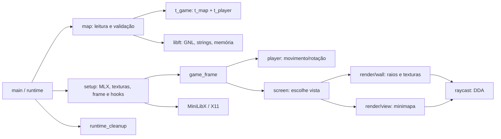
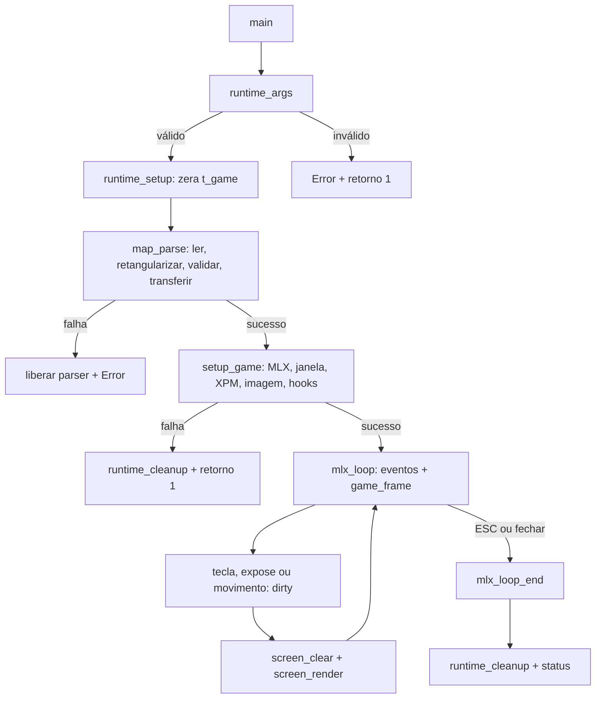

# Revisão técnica do cub3D para a avaliação da 42

Este guia descreve **o estado atual dos arquivos**, não uma implementação idealizada. Caminhos relativos partem da raiz do repositório. `source/` e `header/` formam o programa; `library/libft/` é a biblioteca de utilidades do projeto; `library/mlx/` é a MiniLibX Linux incluída como dependência. Funções `static` ficam visíveis somente no seu arquivo. Nos inventários, “retorna falha” significa o valor efetivamente usado pelo chamador, e não uma promessa universal da API.

**Fonte do subject:** o caminho pedido, `cub-parser/pt_br.subject.pdf`, não está presente na árvore de trabalho: `cub-parser` consta como gitlink removido. Os requisitos e números de páginas abaixo foram conferidos no [PDF disponível na raiz](cub3d.subject.pdf), versão 12.0, em inglês. Antes da defesa, compare a versão portuguesa se ela voltar ao repositório. As páginas citadas são as páginas impressas desse PDF.

## 1. Visão geral e contrato de avaliação

`cub3D` recebe uma cena `.cub`, valida a configuração e a grade, cria uma janela MiniLibX e mostra um labirinto em primeira pessoa. Para cada coluna da imagem, calcula um raio, encontra a primeira parede com DDA e desenha uma faixa da textura associada à face atingida. Teto e chão recebem as cores da cena. [main](source/main.c), [parser](source/map/map.c), [DDA](source/raycast.c), [projeção](source/render/wall.c).

| Exigência do subject | Evidência no projeto | Situação a demonstrar |
| --- | --- | --- |
| C, MiniLibX, raycasting e janela | [Makefile](Makefile), `setup_game`, `render_3d` | Compilar e abrir uma cena. |
| Primeiro argumento `.cub`; configurações em qualquer ordem antes do mapa | `runtime_args`, `map_read_archive`, `map_parse_config` | Abrir cena válida e rejeitar extensão/argumentos errados. |
| Texturas NO, SO, WE, EA por face | `texture_load`, `texture_face` | Ver as quatro faces com texturas distintas. |
| Cores diferentes de teto e chão, RGB 0–255 | `map_parse_color`, `_render_background` | Mudar F e C em um arquivo de teste. |
| Setas esquerda/direita; W/A/S/D; ESC e botão de fechar | `common_kid`, `hook_press`, `runtime_close` | Demonstrar teclas, janela e encerramento. |
| Grade com `0`, `1`, `N/S/E/W`; espaços preservados; mapa fechado | `map_reader`, `map_rectangularize`, `map_validate` | Testar mapa irregular, saída aberta e posição duplicada. |
| `Error\n` seguido de mensagem em configuração inválida | `common_error`, `map_parse` | Observar a saída padrão de erro. |
| Makefile, Norm e README | [Makefile](Makefile), [README.md](README.md) | Conferir regras, build repetido e Norm na versão entregue. |

Esses itens constam da parte obrigatória do [subject, pp. 9–12](cub3d.subject.pdf). As regras comuns de flags, ausência de relink desnecessário, libft e memória estão nas pp. 5–6; README na p. 13. O documento descreve o caminho de código que atende aos itens, mas uma leitura estática não substitui uma execução em ambiente X11.

**Adicionais implementados:** colisão com paredes (`_player_position_valid`), minimapa sobreposto à vista 3D e vista de mapa ocupando a janela (`screen_render`). Colisão e minimapa constam da lista de bônus do [subject, p. 14](cub3d.subject.pdf); não são necessários para provar a parte obrigatória. A tecla M, setas cima/baixo, indicador de jogador e raios de campo de visão também são comportamentos observáveis no código. O alvo `bonus` do Makefile chama `all`: ele não monta um programa alternativo com arquivos `_bonus`.

## 2. Organização e dados



- [source/](source/) contém o ciclo de vida, entrada, jogador, raycasting, tela e texturas. [source/map/](source/map/) reúne o parser; [source/render/](source/render/) reúne desenho, minimapa, FOV e projeção. [header/core/](header/core/) contém tipos, enums e valores compartilhados; [header/source/](header/source/) expõe interfaces dos módulos.
- [library/libft/](library/libft/) fornece `ft_get_next_line`, conversões, strings, memória, impressão e estruturas de dados. O programa usa principalmente GNL, strings, `ft_calloc`, `ft_memcpy`, `ft_memset` e escrita de erros. As demais rotinas da biblioteca existem, mas não devem ser confundidas com etapas do raycaster.
- [library/mlx/](library/mlx/) contém a API gráfica de terceiros e seu código X11. [textures/](textures/) contém XPM; [maps/](maps/) contém quatro cenas de exemplo. [MIGRATING.md](MIGRATING.md) registra a migração do parser, mas alguns caminhos históricos já não existem.

| Arquivo de apoio | Papel atual |
| --- | --- |
| [Makefile](Makefile) | Descobre `.c` de `source/`, `source/map/` e `source/render/`, compila dependências e liga `cub3D`; `bonus: all`. |
| [maps/001.cub](maps/001.cub) | Cena pequena com jogador E; útil para primeira execução. |
| [maps/002.cub](maps/002.cub) | Cena mais larga, jogador S, paredes internas. |
| [maps/003.cub](maps/003.cub) | Cena de nove linhas/colunas, jogador W. |
| [maps/004.cub](maps/004.cub) | Cena mais alta, jogador S. |
| [textures/north.xpm](textures/north.xpm), [south.xpm](textures/south.xpm), [west.xpm](textures/west.xpm), [east.xpm](textures/east.xpm) | Quatro imagens XPM de 16×16 pixels; cada arquivo declara duas cores. O exemplo matemático de textura 64×64 adiante é deliberadamente ilustrativo. |
| [README.md](README.md) | Apresentação, compilação, execução, referências e uso de IA exigidos pelo subject. |
| [MIGRATING.md](MIGRATING.md) | Registro histórico de plano/migração do parser; não é executado. |

Na dependência, [library/mlx/Makefile](library/mlx/Makefile) invoca `configure`, [Makefile.mk](library/mlx/Makefile.mk) define os `.c` ligados, [rgb2c.pl](library/mlx/rgb2c.pl) é utilitário de geração da tabela de cores e [test/run_tests.sh](library/mlx/test/run_tests.sh) pertence à suíte da biblioteca, não ao jogo. Os manuais em `library/mlx/man/` são referências de API.

Em [struct.h](header/core/struct.h), `t_game *g` é o estado principal passado aos módulos: `map`, `player`, `frame`, quatro `texture`, contexto e janela MLX, teclas, vista, estado de erro, tempo e sinal `dirty`. `t_map` mantém a grade retangular, dimensões, caminhos das texturas e cores. `t_player` usa posição contínua, vetor de direção e plano da câmera. `t_img` une o ponteiro opaco da MLX ao endereço de bytes, passo de linha e formato. `t_raycast` guarda direção do raio, estado DDA e impacto; `t_column` guarda a projeção de uma coluna. Em [map.h](header/source/map.h), `t_map_data` é o estado temporário do parser; `t_map_flood` guarda a fila/visitas da checagem de conectividade. O parser só transfere a posse da grade para `g->map` após validar (`_map_transfer`).

## 3. Execução, propriedade e encerramento



`main` valida `argc`/sufixo e chama `runtime_setup`; este inicializa `g` com zero. `map_parse` lê com `ft_get_next_line`, mantém a cena em `t_map_data`, retangulariza e valida. Em caso de sucesso, `_map_transfer` move o `t_map` para `g`, converte o marcador inicial do jogador em `T_FLOOR`, coloca o jogador no centro da célula e calcula direção/plano. Em falha, `map_cleanup` libera somente o estado temporário. [main.c](source/main.c), [runtime.c](source/runtime.c), [map.c](source/map/map.c).

`setup_game` cria contexto e janela MLX, carrega quatro XPM, cria o `frame` e obtém seu endereço. Depois instala hooks para pressionar/soltar tecla, perder foco, expor a janela, fechar pelo gerenciador e executar `game_frame` no loop. A primeira imagem é solicitada porque `runtime_setup` marca `dirty=1`. [setup.c](source/setup.c), [texture.c](source/texture.c).

`game_frame` retorna cedo quando não há mudança de imagem nem tecla de movimento pressionada. Caso contrário mede `elapsed` com `gettimeofday`, limita o intervalo a `PLAYER_MAX_ELAPSED`, atualiza jogador e marca a imagem como suja apenas quando posição/direção/plano mudaram. `_game_render` limpa e desenha só se `dirty` está ativo. Pressão/liberação de tecla, mudança de vista e `Expose` também invalidam a imagem; `FocusOut` limpa teclas para evitar movimento preso. [game.c](source/game.c), [hook.c](source/hook.c), [screen.c](source/screen.c).

`runtime_close` pede `mlx_loop_end`; ao retornar de `mlx_loop`, `runtime_run` chama `runtime_cleanup`. A limpeza destrói texturas e frame, janela, display/ponteiro MLX e mapa, nessa ordem. O mesmo limpador trata uma falha parcial de setup porque `t_game` foi zerado. O fechamento via cruz vermelha é despachado pela MiniLibX: o `ClientMessage` de `WM_DELETE_WINDOW` chama o hook registrado em `DestroyNotify` (`EVT_EXIT=17`). [runtime.c](source/runtime.c), [mlx_loop.c](library/mlx/mlx_loop.c).

## 4. Formato `.cub` e validação

`map_read_archive` confirma o sufixo, usa `open`, lê linhas com GNL e fecha o fd. Antes do mapa, linhas em branco são ignoradas; linhas não reconhecidas como início de grade são passadas ao parser de configuração. Texturas `NO`, `SO`, `WE`, `EA` recebem caminhos não vazios e sem duplicação; `F` e `C` recebem três componentes decimais de 0 a 255, separados por vírgula. `CUB_*` em [enum.h](header/core/enum.h) são bits de presença; `CUB_REQ_FIELDS` exige os seis. O RGB vira `(R << 16) | (G << 8) | B`. [map_reader.c](source/map/map_reader.c), [map_config.c](source/map/map_config.c), [map_color.c](source/map/map_color.c).

Depois da primeira linha reconhecida como mapa, todas as linhas seguintes são linhas de mapa. A linha original perde somente o `\n` final; espaços da grade são preservados. `map_rectangularize` copia cada linha para a largura máxima e preenche células ausentes com espaço, de modo que `grid[y][x]` seja seguro dentro das dimensões. `map_validate` exige dimensão mínima 3×3, caracteres permitidos, exatamente um jogador e quatro vizinhos válidos (`1` ou caminhável) para cada `0`/marcador. `map_cell_at` devolve espaço fora da grade, fazendo a borda aberta falhar. Por fim, a busca em largura parte do jogador e exige alcançar todas as células caminháveis; **conectividade é exigência extra do código, não aparece expressamente no subject**. [map_grid.c](source/map/map_grid.c), [map_validate.c](source/map/map_validate.c), [map_connectivity.c](source/map/map_connectivity.c).

Exemplo conceitual válido, usando os caminhos XPM do repositório (os arquivos precisam existir quando executado):

```text
NO textures/north.xpm
SO textures/south.xpm
WE textures/west.xpm
EA textures/east.xpm
F 50, 50, 50
C 110, 160, 210

111111
10E001
100001
111111
```

Casos inválidos úteis para a defesa: trocar `E` por `X` cria símbolo proibido; pôr dois marcadores cria dois jogadores; trocar o `1` da borda junto a um `0` por espaço abre o mapa; repetir `NO` ou omitir `C` falha nos campos; `F 256,0,0` excede RGB; inserir `F ...` após a primeira linha de mapa vira conteúdo de mapa inválido. Uma linha curta **pode** ser válida se o espaço que a completa ficar separado de todas as células caminháveis por paredes. Estes são exemplos conceituais; as cenas executáveis estão em [maps/](maps/).

```text
Grade conceitual, x cresce →, y cresce ↓
  x: 0 1 2 3 4 5
y=0  1 1 1 1 1 1
y=1  1 0 0 0 0 1
y=2  1 0 E 0 1 1    E: posição inicial, olhando para +x
y=3  1 0 0 0 0 1    espaço ' ': vazio/fora do labirinto
y=4  1 1 1 1 1 1
```

## 5. Matemática da câmera, DDA e textura

As coordenadas da grade têm origem no canto superior esquerdo: `x` cresce para a direita e `y` para baixo. Uma célula `(i,j)` ocupa `[i,i+1)×[j,j+1)`. O jogador nasce em `(i+0,5,j+0,5)`. `N=(0,-1)`, `S=(0,1)`, `E=(1,0)`, `W=(-1,0)`. Para `d=(d_x,d_y)` e escala `s=PLAYER_PLANE_SCALE=0,66`, o plano é `p=(-d_y s,d_x s)`; o produto escalar `d·p=0`. Esse plano representa as extremidades laterais do campo de visão, sem mover a câmera no mapa. [map.c: `_map_apply_player`](source/map/map.c), [const.h](header/core/const.h).

```text
Exemplo conceitual com E e s=0,66:

             borda esquerda do plano  (0,-0,66)
                      |
                      |
           jogador P  +────────→ direção d=(1,0)
                      |
                      |
             borda direita do plano   (0,+0,66)

O desenho segue o eixo y da tela: baixo é positivo.
```

Para coluna inteira `x` de uma imagem com largura `W`, `_render_3d_column` calcula

$$c_x=\frac{2x}{W}-1,\qquad r=d+c_xp.$$

`c_x` varia de `-1` até pouco menos de `+1`; `r` é o vetor do raio, não precisa ser normalizado. A coluna central (`x=W/2`, se W par) usa `r=d`. No minimapa completo, `_render_fov_ray` amostra `RENDER_FOV_RAYS=41` raios com `c_i=2i/(41-1)-1`, incluindo os dois limites. [wall.c: `_render_3d_column`](source/render/wall.c), [fov.c: `_render_fov_ray`](source/render/fov.c).

O DDA começa em `map_x=floor(P_x)`, `map_y=floor(P_y)` e escolhe `step_x,step_y` iguais a `+1` ou `-1` segundo o sinal do raio. A distância, em parâmetro de raio, entre travessias sucessivas de linhas verticais/horizontais é

$$\Delta_x=\left|\frac{1}{r_x}\right|,\qquad \Delta_y=\left|\frac{1}{r_y}\right|.$$

Se um componente é zero, o código usa `1e30` como substituto prático de distância infinita. As primeiras distâncias são

$$S_x=|map_x+[step_x>0]-P_x|\Delta_x,\qquad S_y=|map_y+[step_y>0]-P_y|\Delta_y.$$

O colchete vale 1 se a condição é verdadeira, 0 caso contrário. `_raycast_advance` escolhe o menor `S`, entra na célula vizinha daquele eixo, guarda o `S` antigo em `hit.distance` e soma `\Delta` ao `S` daquele eixo. Em empate escolhe Y. `_raycast_is_hit` termina na primeira célula diferente de `T_FLOOR` e calcula o ponto `H=P+r\,t`, com `t=hit.distance`. O laço é limitado a `map.width+map.height` passos e verifica limites antes de acessar a grade. [raycast.c](source/raycast.c).

`t` funciona como distância perpendicular à câmera nesta parametrização: a direção `d` é unitária, o plano `p` é perpendicular e, portanto, `d·r=1`; a componente frontal de `H-P=r t` é `d·(H-P)=t`. Assim evita-se a distorção de usar o comprimento euclidiano do raio oblíquo. Isso depende de manter direção unitária e plano perpendicular, como faz `_map_apply_player` e a rotação conjunta de `_player_rotate`. [map.c](source/map/map.c), [player.c](source/player.c), [raycast.c](source/raycast.c).

**Exemplo didático calculado, com tela reduzida para 8×6 pixels** (o programa real usa `1024×768`): jogador `P=(2,5;2,5)` virado para E; coluna `x=4` dá `c_x=0`, `r=(1,0)`. Começa na célula `(2,2)`. `\Delta_x=1`, `\Delta_y=1e30`, `S_x=0,5`; o primeiro passo entra em `(3,2)` com `t=0,5` (chão). O segundo entra em `(4,2)` com `t=1,5` (parede no mapa acima). O impacto é `H=(4;2,5)`, lado `RAYSIDE_X`, face `TEX_WE` porque o raio veio de x menor e `r_x>0`. [raycast.c](source/raycast.c), [texture.c: `texture_face`](source/texture.c).

```text
                         linhas verticais da grade
P=(2,5;2,5) ──────→ | x=3        | x=4, parede
                    t=0,5         t=1,5
              célula (3,2)   célula (4,2)
```

Para altura real de imagem `H`, `_render_column_setup` usa `t'=max(t,RENDER_MIN_DISTANCE)` e calcula

$$h=\left\lfloor\frac{H}{t'}\right\rfloor,\quad top=\left\lfloor\frac{H}{2}\right\rfloor-\left\lfloor\frac{h}{2}\right\rfloor,\quad start=max(top,0),\quad end=min(top+h,H).$$

Há truncamento para `int` em `h`, `start` e `end`; a expressão do `top` acima representa a divisão inteira C dos operandos positivos. O código desenha linhas `y` em `[start,end)`. No exemplo `H=6`, `t=1,5`, `h=4`, `top=1`, logo a parede ocupa `y=1,2,3,4`; teto fica em `y=0` e chão em `y=5`. [wall.c: `_render_column_setup`, `_render_background`, `_render_wall`](source/render/wall.c).

Para a textura, a coordenada ao longo da face é a parte fracionária de `hit.y` ao cruzar X, ou de `hit.x` ao cruzar Y. Com textura de largura `T_w`, `tex_x=(int)(u T_w)`. O código espelha `tex_x` para `RAYSIDE_X` com `ray_x>0` ou `RAYSIDE_Y` com `ray_y<0`. A linha da textura é `tex_y=(int)((y-top)T_h/h)`, onde `T_h` é a altura da textura. No exemplo, `u=0,5`, `T_w=64` produz 32 e o espelhamento produz 31; se `T_h=64`, as quatro linhas visíveis amostram `0,16,32,48`. [wall.c](source/render/wall.c).

```text
Tela 8×6, coluna x=4       Textura 64×64
 y=0  teto                 
 y=1  tex(31, 0)  ───────→ faixa superior
 y=2  tex(31,16)
 y=3  tex(31,32)
 y=4  tex(31,48) ────────→ faixa inferior
 y=5  chão
```

`_render_background` pinta cada coluna com `color_ceiling` acima da metade e `color_floor` abaixo, antes de sobrepor a parede. `render_px` e `_render_wall` escrevem no buffer com `addr + y*llen + x*(bpp/8)`; `llen` é o passo real da linha, que pode incluir preenchimento. `texture_load` exige `bpp==32` para as quatro XPM. A implementação escreve inteiros de 32 bits diretamente e, portanto, pressupõe um formato de frame compatível; o frame não é explicitamente validado como 32 bpp. [draw.c](source/render/draw.c), [wall.c](source/render/wall.c), [texture.c](source/texture.c), [setup.c](source/setup.c).

## 6. Movimento, eventos e minimapa

| Entrada | Estado/ação real | Código |
| --- | --- | --- |
| W ou ↑ / S ou ↓ | `GK_FORWARD` / `GK_BACKWARD` | `common_kid`, `_player_move` |
| A / D | `GK_LEFT` / `GK_RIGHT` (deslocamento lateral) | `common_kid`, `_player_move` |
| ← / → | `GK_ACLOCKWISE` / `GK_CLOCKWISE` | `common_kid`, `player_update` |
| M | Alterna `V_3D` e `V_MINIMAP`, com trava até soltar | `hook_press`, `screen_toggle_view` |
| ESC / cruz da janela | Pede fim do loop; limpa após `mlx_loop` retornar | `runtime_close`, `runtime_run` |
| Perda de foco / Expose | Limpa teclas / invalida o quadro | `hook_out`, `hook_expose` |

Em `_player_move`, `fw=forward-backward`, `st=left-right`; o par é normalizado por `sqrt(fw²+st²)` para evitar avanço diagonal mais rápido. Para `d=(d_x,d_y)`, o deslocamento é `dx=(d_x fw+d_y st)v\Delta t` e `dy=(d_y fw-d_x st)v\Delta t`, com `v=PLAYER_SPEED`. O jogador testa X e Y separadamente; isso permite deslizar junto à parede. `_player_position_valid` exige que os quatro cantos `(x±r,y±r)` da caixa, com `r=PLAYER_RADIUS=0,2`, estejam em `T_FLOOR`. Esse teste aproxima uma caixa quadrada, não um círculo exato. [player.c](source/player.c), [const.h](header/core/const.h).

`_player_rotate` aplica a mesma matriz a `dir` e `plane`: `x'=x cosθ-y sinθ`, `y'=x sinθ+y cosθ`. Como y cresce para baixo, ângulo positivo aparece como giro horário na tela. A seta direita usa `+PLAYER_ROTATION_SPEED*elapsed`; a esquerda usa o negativo. [player.c](source/player.c).

Em `V_3D`, `screen_render` primeiro desenha as colunas 3D e depois um minimapa no canto superior direito. `_screen_overlay` limita sua largura/altura a 256 pixels, com margem 16, mantendo a proporção calculada por `min(256/map.width,256/map.height)`. Em `V_MINIMAP`, a viewport é a imagem toda (`1024×768`); a conversão de coordenadas escala X e Y separadamente, então mapas não proporcionais podem ficar esticados. `render_map_view` desenha as células, 41 raios de FOV e um quadrado para o jogador; o quadrado é somente marcador visual, diferente de `PLAYER_RADIUS`. [screen.c](source/screen.c), [view.c](source/render/view.c), [fov.c](source/render/fov.c), [draw.c](source/render/draw.c).

## 7. Falhas e limites observáveis

**Tratamento confirmado:** erro de argumentos, arquivo inválido/inexistente, ausência/duplicação dos seis campos, RGB malformado ou fora da faixa, caracteres inválidos, número de jogadores diferente de um, abertura junto a área caminhável, componentes caminháveis desconectados, falha ao carregar XPM, falha de inicialização gráfica, falha de relógio e falha de renderização seguem caminhos de retorno de erro. `common_error` imprime `Error` e mensagem em stderr. Em `map_parse`, diferentes falhas do parser convergem para `Invalid map file`, uma mensagem válida, porém pouco específica. [common.c](source/common.c), [map.c](source/map/map.c), [setup.c](source/setup.c), [game.c](source/game.c).

**Limites/questões para confirmar em testes:** a busca por conectividade pode rejeitar um mapa fechado com bolsão isolado, além do requisito explícito do subject; a leitura por GNL usa `NULL` tanto para EOF quanto para erro de leitura, então `map_read_archive` não distingue os dois se já coletou linhas; `1e30` é um valor sentinela do DDA; os pixels são gravados como 32 bits sem verificação do bpp do frame; o código da MiniLibX disponível é a variante Linux/X11 e as teclas são keysyms dessa plataforma. A rotina `_map_resize_grid` usa `malloc`, copia os ponteiros existentes com `ft_memcpy` e libera a antiga tabela apenas após sucesso. Esses pontos são observações de código, **não** resultados de uma campanha de testes. [map_connectivity.c](source/map/map_connectivity.c), [map_reader.c](source/map/map_reader.c), [raycast.c](source/raycast.c), [draw.c](source/render/draw.c).

**Melhorias sugeridas, ainda não aplicadas:** separar erro de leitura de EOF no contrato GNL/parser; considerar se conectividade deve ser obrigatória; validar o formato de `frame` antes de escrever `unsigned int`; centralizar caracteres de direção/espaço e limites como `255`/`1e30` em nomes; ampliar mensagens específicas do parser. Nenhuma destas sugestões deve ser apresentada na defesa como funcionalidade implementada.

## 8. Roteiro curto para a defesa

1. Rodar `make`, executar `make` de novo e confirmar que não há relink desnecessário; executar `./cub3D maps/001.cub` e ao menos um mapa maior. Conferir `norminette` no conjunto entregue. [Makefile](Makefile).
2. Demonstrar quatro texturas, F/C distintos, W/A/S/D, ambas as setas de giro, ESC e cruz da janela. Se o avaliador usar janela minimizada/trocada, `Expose` deve pedir redesenho. [hook.c](source/hook.c), [screen.c](source/screen.c).
3. Testar um arquivo inválido por vez: argumento errado, campo ausente/repetido, RGB 256, sem jogador, dois jogadores, parede aberta e linha irregular fechada. Verificar `Error` e encerramento sem crash. [map/](source/map/).
4. Explicar, apontando o código, como `t_map_data` vira `t_game`, como uma coluna gera um raio, por que o DDA avança por eixos e por que a altura usa distância frontal. [map.c](source/map/map.c), [wall.c](source/render/wall.c), [raycast.c](source/raycast.c).
5. Verificar memória com a ferramenta permitida no ambiente da defesa e confirmar se os arquivos enviados ao Git incluem texturas, mapas, libft, MiniLibX e README. O subject avalia o que está no repositório, não só a árvore local ([subject, pp. 5–6 e 18](cub3d.subject.pdf)).

| Pergunta provável | Resposta baseada no código |
| --- | --- |
| Por que `t_map_data` separado? | Mantém arquivo e validação em estado temporário; `_map_transfer` só passa a grade validada a `t_game`. |
| Por que `0,5` na posição inicial? | Converte índice inteiro da célula para seu centro contínuo. |
| Por que o plano é perpendicular? | `(-d_y,d_x)` tem produto escalar zero com `d`; seus múltiplos deslocam raios lateralmente. |
| O que é `side_x`/`side_y`? | Distância parametrizada até a próxima linha vertical/horizontal da grade. |
| Por que a parede usa `H/distance`? | Projeção em perspectiva: um segmento de mesma altura ocupa menos pixels quanto mais distante. |
| Por que usar `llen`? | O passo entre linhas do buffer pode diferir de `width*bytes_por_pixel`. |
| Por que `dirty`? | Evita traçar todas as colunas quando a imagem não mudou. |
| Como ESC evita o segfault de limpeza? | O hook encerra o loop; a destruição ocorre depois que `mlx_loop` retorna. |

Pequenas mudanças que **podem** ser propostas em uma avaliação, sem afirmar que serão pedidas: trocar a velocidade em [const.h](header/core/const.h); alterar tecla em `common_kid` e constantes; mudar cor/posição do marcador em `_render_player`; alterar limite do minimapa em `_screen_overlay`; aumentar detalhe de erro em `map_parse`/`map_parse_config`. Antes da defesa, cada autor deve conseguir derivar `r=d+c_xp`, `S_x/S_y`, `h=H/t`, `tex_x/tex_y`, a matriz de rotação, a posse dos recursos e o caminho de limpeza sem consultar este arquivo.

## 9. Inventário dos headers

Os headers não executam funções: publicam tipos/constantes/protótipos para os `.c`. A lista abaixo também indica onde o contrato é consumido.

| Header | Declarações e uso |
| --- | --- |
| [header/core/const.h](header/core/const.h) | Nome e resolução `S_WIDTH=1024`, `S_HEIGHT=768`; tamanho/margem do minimapa; velocidade, raio de colisão, escala do plano, teto de `elapsed`; quantidade de raios FOV e distância mínima; cores; números de evento/máscara X11 e keysyms Linux. Usado por setup, jogo, movimento, tela e renderização. |
| [header/core/enum.h](header/core/enum.h) | `t_tile` (`T_FLOOR='0'`, `T_WALL='1'`); `t_gkey` e `GK_COUNT` indexam `g->keys`; `t_view` escolhe 3D/minimapa; `t_ray_side` identifica o eixo cruzado; `t_texture` indexa quatro `g->texture`; `t_cub_field` são bits e máscara obrigatória do parser. Direções N/S/E/W e espaço ainda aparecem como caracteres literais. |
| [header/core/struct.h](header/core/struct.h) | `t_img`, `t_player`, `t_line`, `t_ray_hit`, `t_ray_state`, `t_raycast`, `t_point`, `t_viewport`, `t_column`, `t_map`, `t_game`; conectam mapa, câmera, DDA, imagem e ciclo de vida. |
| [header/core/cub3d.h](header/core/cub3d.h) | Agrega `const.h`, `enum.h`, `struct.h`; os `.c` atuais preferem inclusões específicas. |
| [header/source/common.h](header/source/common.h) | `common_now`, `common_kid`, `common_error`; relógio, tradução de teclas e mensagem de erro. |
| [header/source/game.h](header/source/game.h) | `game_frame`, callback do loop MLX. |
| [header/source/hook.h](header/source/hook.h) | `hook_press`, `hook_release`, `hook_out`, `hook_expose`, callbacks dos eventos. |
| [header/source/map.h](header/source/map.h) | `t_map_data`, `t_map_flood` e protótipos de leitura, configuração, validação, grade, conectividade, transferência/limpeza do mapa. |
| [header/source/player.h](header/source/player.h) | `player_update`, integra movimento/rotação por tempo decorrido. |
| [header/source/raycast.h](header/source/raycast.h) | `raycast_cast`, usado por colunas e minimapa. |
| [header/source/render.h](header/source/render.h) | Entrada das vistas 3D/mapa/FOV e primitivas de ponto/linha/retângulo/conversão de coordenadas. |
| [header/source/runtime.h](header/source/runtime.h) | Argumentos, setup/run/close e limpeza da aplicação. |
| [header/source/screen.h](header/source/screen.h) | Alternância de vista, limpeza de frame e apresentação. |
| [header/source/setup.h](header/source/setup.h) | `setup_game`, inicialização MLX. |
| [header/source/texture.h](header/source/texture.h) | Carregamento, destruição e seleção de face das texturas. |
| [library/libft/libft.h](library/libft/libft.h) | API geral da libft; `t_list`, `t_dlist_node`, `t_dlist`, `t_array`, `t_bool`; protótipos das rotinas dos grupos do inventário a seguir. |
| [library/libft/lib/ft_gnline/get_next_line.h](library/libft/lib/ft_gnline/get_next_line.h) | `BUFFER_SIZE` padrão 1, `t_gnl_state` por fd e operações de buffer/linha/remoção usadas pelo GNL. |
| [library/libft/lib/ft_printf/ft_printf.h](library/libft/lib/ft_printf/ft_printf.h) | Protótipos dos manipuladores internos de números, hexadecimal e ponteiros do `ft_printf`. |
| [library/mlx/mlx.h](library/mlx/mlx.h) | API pública da MiniLibX: contexto, janela, imagem, XPM, eventos, loop, mouse e destruição. |
| [library/mlx/mlx_int.h](library/mlx/mlx_int.h) | Tipos internos `t_xvar` (display X11), `t_win_list`, `t_img` interno da MLX, eventos e protótipos auxiliares. O `t_img` da MLX está separado do `t_img` do projeto por unidade de compilação; não devem ser tratados como a mesma estrutura. |

## 10. Inventário de funções do programa (`source/`)

Convenção: **S** identifica uma função `static`; ela só pode ser chamada dentro do arquivo indicado. Nas descrições, `g` é `t_game *`, `data` é `t_map_data *`, `rc` é `t_raycast *`; parâmetros com outro nome são descritos quando relevantes. Funções `void` apenas modificam estado/recursos; callbacks `int` devolvem normalmente 0 para a MLX. Cada link aponta para o arquivo onde todas as funções da respectiva linha estão definidas.

| Arquivo | Funções, entradas, saídas e efeitos |
| --- | --- |
| [source/main.c](source/main.c) | `main(argc,argv)`: recebe CLI, chama validação/setup/loop e devolve 1 por falha inicial ou o `g.status` após limpar. |
| [source/common.c](source/common.c) | `common_kid(keycode)`: converte keysym em índice `GK_*`, ou -1 se desconhecido; não altera estado. `common_now()`: lê `gettimeofday`, devolve segundos `double` ou -1. `common_error(message)`: escreve `Error` e mensagem em stderr, devolve 1. |
| [source/runtime.c](source/runtime.c) | `runtime_args(argc,argv)`: exige um argumento `.cub`; devolve 0/1 e escreve erro na falha. `runtime_cleanup(g)`: destrói imagens, janela, display e mapa, zerando ponteiros de runtime. `runtime_setup(g,map_path)`: zera `g`, faz parse/setup, marca `dirty`, limpa e devolve 1 na falha. `runtime_run(g)`: entra no loop, limpa ao sair, devolve `g->status`. `runtime_close(g)`: chama `mlx_loop_end`; retorna 0 para o hook. |
| [source/setup.c](source/setup.c) | **S** `_setup_mlx(g)`: cria contexto e janela `S_WIDTH×S_HEIGHT`; devolve 0/1. **S** `_setup_hook(g)`: registra callbacks de teclado/foco/Expose/fechamento/loop; sem retorno. **S** `_setup_frame(g)`: cria imagem, obtém `addr/bpp/llen/endian`, zera bytes; devolve 0/1. `setup_game(g)`: executa essas etapas e `texture_load` em ordem; devolve 0/1. |
| [source/game.c](source/game.c) | **S** `_game_has_motion(g)`: indica se tecla de mover/girar está pressionada. **S** `_game_player_changed(old,current)`: compara posição, direção e plano; devolve booleano. **S** `_game_update_player(g,elapsed)`: chama `player_update` e marca `dirty` se houve mudança. **S** `_game_render(g)`: limpa e renderiza quando `dirty`, pede saída e grava `status` em falha. `game_frame(g)`: mede/clampa `elapsed`, atualiza e desenha só quando necessário; callback retorna 0. |
| [source/hook.c](source/hook.c) | `hook_press(keycode,g)`: ESC pede fim; M alterna uma vez por pressão; demais teclas ativam `g->keys`/`dirty`; retorna 0. `hook_release(keycode,g)`: desativa tecla e marca `dirty`; retorna 0. `hook_out(g)`: zera todas as teclas ao perder foco; retorna 0. `hook_expose(g)`: marca redraw; retorna 0. |
| [source/player.c](source/player.c) | **S** `_player_cell_blocked(g,x,y)`: converte ponto contínuo para célula e retorna 1 se fora/parede. **S** `_player_position_valid(g,x,y)`: testa os quatro cantos da caixa de colisão; devolve booleano. **S** `_player_move(g,elapsed)`: normaliza teclas W/A/S/D, move separadamente nos eixos se a posição for válida. **S** `_player_rotate(p,angle)`: gira direção e plano do `t_player` pelo mesmo ângulo. `player_update(g,elapsed)`: coordena movimento e giro conforme as teclas. |
| [source/raycast.c](source/raycast.c) | **S** `_raycast_setup(g,rc)`: prepara célula, passos, deltas e primeiras distâncias do raio. **S** `_raycast_advance(rc)`: cruza a próxima linha X/Y e registra `hit.distance`. **S** `_raycast_in_boundaries(g,rc)`: devolve se a célula DDA está dentro da grade. **S** `_raycast_is_hit(g,rc)`: quando a célula não é chão, preenche célula/lado/ponto de impacto e devolve 1. `raycast_cast(g,rc)`: percorre DDA limitado por largura+altura; devolve 1 se encontrou parede, 0 caso contrário. |
| [source/screen.c](source/screen.c) | **S** `_screen_overlay(g)`: calcula viewport proporcional do minimapa no canto superior direito. `screen_toggle_view(g)`: alterna enum `view` e marca `dirty`. `screen_clear(g)`: zera o frame e devolve 0, ou 1 sem endereço válido. `screen_render(g)`: escolhe 3D+overlay ou mapa em tela inteira, apresenta a imagem via MLX; devolve 0/1. |
| [source/texture.c](source/texture.c) | **S** `_texture_load(g,img,path)`: lê XPM em imagem MLX, verifica endereço/dimensões/32 bpp, devolve 0/1 e mensagem em falha. `texture_load(g)`: carrega NO/SO/WE/EA nos índices do enum; devolve 0/1. `texture_cleanup(g)`: destrói cada imagem existente e zera seus metadados. `texture_face(g,rc)`: devolve ponteiro da textura correspondente ao lado e sinal do raio. |
| [source/map/map.c](source/map/map.c) | **S** `_map_apply_player(g,data)`: transforma letra N/S/E/W em vetores e centraliza posição. **S** `_map_transfer(g,data)`: move posse de `data->map`, transforma marcador do spawn em chão e aplica jogador. `map_cleanup(map)`: libera linhas, grade e quatro caminhos; zera `t_map`. `map_parse(g,map_path)`: cria estado temporário, lê/valida e transfere em sucesso; devolve 0/1 e escreve erro genérico na falha. |
| [source/map/map_cells.c](source/map/map_cells.c) | `map_is_player(cell)`: devolve 1 para N/S/E/W. `map_is_walkable(cell)`: devolve 1 para chão ou marcador. `map_cell_at(data,x,y)`: devolve caractere da célula ou espaço para posição inválida. `map_count_walkable(data)`: percorre grade e devolve total caminhável para a checagem de conectividade. |
| [source/map/map_color.c](source/map/map_color.c) | **S** `_map_skip_space(&value)`: avança ponteiro sobre espaços/tabs. **S** `_map_parse_component(&value,&component)`: lê decimal 0–255, atualiza ponteiros e devolve 1/0. **S** `_map_parse_separator(&value)`: consome vírgula ou falha. **S** `_map_parse_rgb(value,&red,&green,&blue)`: exige três componentes e fim da string. `map_parse_color(value,&color)`: empacota `0xRRGGBB`, devolve 1/0. |
| [source/map/map_config.c](source/map/map_config.c) | **S** `_map_texture_field(line)`: converte prefixo NO/SO/WE/EA em bit CUB, ou 0. **S** `_map_texture_slot(data,field)`: devolve endereço do campo de caminho no mapa, ou `NULL`. **S** `_map_parse_texture(data,line)`: valida identificador, duplicação e caminho; grava cópia e bit, devolve 1/0. **S** `_map_parse_color_config(data,line)`: escolhe F/C, valida separador/duplicação/RGB, grava cor/bit; devolve 1/0. `map_parse_config(data,line)`: despacha uma linha de configuração; devolve 1 se aceita. |
| [source/map/map_reader.c](source/map/map_reader.c) | **S** `_map_is_start(line)`: diferencia início da grade de identificadores NO/SO/WE/EA. **S** `_map_resize_grid(data)`: aloca tabela de ponteiros maior, copia os antigos e libera tabela antiga em sucesso; devolve nova tabela ou `NULL`. **S** `_map_append_line(data,line)`: guarda posse da linha, atualiza largura/altura, devolve 1/0. **S** `_map_process_line(data,line)`: ignora branco antes do mapa, despacha config ou guarda linha preservando espaços; libera o que não transfere; devolve 1/0. `map_read_archive(data,path)`: abre `.cub`, lê até EOF/falha, fecha fd, retangulariza; devolve 1/0. |
| [source/map/map_grid.c](source/map/map_grid.c) | **S** `_map_free_grid(grid,height)`: libera linhas e tabela. **S** `_map_pad_row(row,width)`: aloca linha com espaços até `width`, devolve ponteiro ou `NULL`. **S** `_map_copy_grid(map)`: copia todas as linhas para a nova largura, limpa cópia parcial na falha. `map_rectangularize(map)`: substitui grade antiga pela cópia completa; devolve 1/0. |
| [source/map/map_validate.c](source/map/map_validate.c) | **S** `_map_cell_closed(data,x,y)`: exige quatro vizinhos parede/caminháveis. **S** `_map_inspect_line(data,y,&players)`: valida símbolos da linha, conta/guarda jogador; devolve 1/0. **S** `_map_cells_closed(data)`: aplica vizinhança a todas as células caminháveis. **S** `_map_player_count(data)`: percorre linhas; devolve total ou -1 se símbolo inválido. `map_validate(data)`: exige seis campos, dimensão, um jogador, fechamento e conectividade; devolve 1/0. |
| [source/map/map_connectivity.c](source/map/map_connectivity.c) | **S** `_map_flood_add(flood,x,y)`: enfileira caminhável não visitada, devolve 1/0. **S** `_map_flood_neighbours(flood,point)`: tenta quatro vizinhos. **S** `_map_flood_init(flood,data)`: confere tamanhos, aloca fila/visitas e insere jogador; devolve 1/0. **S** `_map_flood_run(flood)`: BFS, devolve número alcançado (ou 0 na falha). `map_connectivity_validate(data)`: compara alcançados ao total, libera fila/visitas; devolve 1 para conectado, 0 para desconectado, -1 se não iniciou. |
| [source/render/draw.c](source/render/draw.c) | **S** `_render_line_step(&p,&line)`: avança uma etapa da linha inteira tipo Bresenham. `render_px(img,p,color)`: grava pixel se está dentro da imagem. `render_line(img,from,to,color)`: desenha segmento inclusive entre dois pontos. `render_rect(img,from,to,color)`: preenche retângulo com limite final exclusivo. `render_map_point(g,v,x,y)`: converte posição no mapa em coordenada inteira da viewport. |
| [source/render/fov.c](source/render/fov.c) | **S** `_render_fov_ray(g,v,i,from)`: calcula i-ésimo raio de FOV, usa DDA e desenha linha até impacto. `render_fov(g,v)`: desenha 41 raios a partir do jogador na viewport. |
| [source/render/view.c](source/render/view.c) | **S** `_render_tile_color(tile)`: mapeia parede/chão/outros em cor do minimapa. **S** `_render_map_cell(g,v,cell)`: desenha retângulo da célula. **S** `_render_map(g,v)`: percorre toda a grade. **S** `_render_player(g,v)`: desenha marcador quadrado no centro do jogador. `render_map_view(g,v)`: compõe células, FOV e jogador na viewport. |
| [source/render/wall.c](source/render/wall.c) | **S** `_render_background(g,x)`: preenche teto e chão da coluna do frame. **S** `_render_column_setup(g,rc,col)`: escolhe textura, altura, recorte e `tex_x`. **S** `_render_wall(g,x,col)`: copia pixels da faixa de textura para a coluna. **S** `_render_3d_column(g,x)`: monta raio da coluna, desenha fundo e parede se houver impacto. `render_3d(g)`: executa todas as colunas do frame. |

## 11. Inventário da libft (`library/libft/`)

A libft é código de utilidade presente no repositório e compilado como `libft.a` pelo seu próprio [Makefile](library/libft/Makefile). As descrições indicam entrada, resultado e eventual alocação/escrita. **S** continua significando `static` privado ao arquivo. A existência de uma função na libft não significa que `cub3D` a chama diretamente.

| Arquivo | Funções, entradas, saídas e efeitos |
| --- | --- |
| [util/ft_isalpha.c](library/libft/util/ft_isalpha.c) | `ft_isalpha(c)`: devolve booleano para letra ASCII maiúscula/minúscula. |
| [util/ft_isdigit.c](library/libft/util/ft_isdigit.c) | `ft_isdigit(c)`: devolve booleano para `'0'`–`'9'`. |
| [util/ft_isalnum.c](library/libft/util/ft_isalnum.c) | `ft_isalnum(c)`: combina os dois predicados anteriores. |
| [util/ft_isascii.c](library/libft/util/ft_isascii.c) | `ft_isascii(c)`: testa intervalo 0–127. |
| [util/ft_isprint.c](library/libft/util/ft_isprint.c) | `ft_isprint(c)`: testa ASCII imprimível 32–126. |
| [mem/ft_bzero.c](library/libft/mem/ft_bzero.c) | `ft_bzero(b,n)`: escreve zero nos `n` bytes via `ft_memset`; `void`. |
| [mem/ft_calloc.c](library/libft/mem/ft_calloc.c) | `ft_calloc(count,size)`: verifica overflow, aloca e zera bytes; devolve ponteiro ou `NULL`. |
| [mem/ft_memchr.c](library/libft/mem/ft_memchr.c) | `ft_memchr(s,c,n)`: procura byte nos primeiros `n`, devolve endereço ou `NULL`. |
| [mem/ft_memcmp.c](library/libft/mem/ft_memcmp.c) | `ft_memcmp(s1,s2,n)`: devolve diferença do primeiro par de bytes distintos, ou 0. |
| [mem/ft_memcpy.c](library/libft/mem/ft_memcpy.c) | `ft_memcpy(dst,src,n)`: copia bytes sem tratar sobreposição; devolve `dst` (ou `NULL` se ponteiro ausente com `n>0`). Usada na tabela de linhas do parser. |
| [mem/ft_memmove.c](library/libft/mem/ft_memmove.c) | **S** `_memmove_forward(dst,src,n)` e **S** `_memmove_backward(dst,src,n)`: copiam bytes na direção adequada; `void`. `ft_memmove(dst,src,n)`: escolhe direção para regiões sobrepostas e devolve `dst`/`NULL`. |
| [mem/ft_memset.c](library/libft/mem/ft_memset.c) | `ft_memset(b,c,n)`: preenche `n` bytes com `c`, devolve `b`; zera o frame com `c=0`. |
| [mem/ft_secfree.c](library/libft/mem/ft_secfree.c) | `ft_secfree(buffer,size)`: percorre `size` endereços de ponteiros, libera cada valor não nulo e zera o original; devolve `NULL`. |
| [num/ft_atof.c](library/libft/num/ft_atof.c) | **S** `_atof_count_digits(&str)`: avança e conta dígitos; **S** `_atof_integer(&str)`: acumula parte inteira; **S** `_atof_fraction(&str)`: soma casas fracionárias; `ft_vatof(str)`: valida formato decimal com sinal/ponto e devolve booleano; `ft_atof(str)`: converte formato válido em `double`, ou 0 para inválido. |
| [num/ft_atoi.c](library/libft/num/ft_atoi.c) | **S** `_atoi_digits_valid(str,limit)`: valida dígitos e overflow contra limite; `ft_vatoi(str)`: valida inteiro textual com sinal nos limites de `int`; `ft_atoi(str)`: usa `ft_atoll` e limita resultado a `INT_MIN..INT_MAX`. |
| [num/ft_atoll.c](library/libft/num/ft_atoll.c) | **S** `_atoll_digits(str,signal)`: acumula dígitos e satura nos limites de `long long`; `ft_atoll(str)`: salta espaço inicial, lê sinal e devolve resultado. |
| [num/ft_digits.c](library/libft/num/ft_digits.c) | `ft_digits(v,size)`: conta dígitos de `size_t` na base `size`, ou 0 para base menor que 2. |
| [num/ft_itoa.c](library/libft/num/ft_itoa.c) | `ft_itoa(n)`: aloca representação decimal de `int`; devolve string ou `NULL`. |
| [num/ft_itoab.c](library/libft/num/ft_itoab.c) | **S** `_itoab_valid_base(base)`: exige pelo menos dois caracteres únicos sem `+/-`; **S** `_itoab_create(value,base,sign)`: aloca representação na base; `ft_itoab(value,base)`: converte inteiro com sinal; `ft_itoab_uns(value,base)`: converte `size_t` sem sinal. Retornam string alocada ou `NULL`. |
| [num/ft_signal.c](library/libft/num/ft_signal.c) | `ft_abs(v)`: módulo de `int`, com -1 para `INT_MIN`; `ft_signal(v)`: devolve -1 para negativo e +1 para zero/positivo. |
| [num/ft_utils.c](library/libft/num/ft_utils.c) | `ft_lowerof(a,b)`: devolve o menor inteiro. |
| [str/ft_padstr.c](library/libft/str/ft_padstr.c) | `ft_padstart(str,max_size,placeholder)`: aloca cópia com prefixo até a largura pedida; `NULL` em falha. |
| [str/ft_split.c](library/libft/str/ft_split.c) | **S** `_split_count_words(s,c)`: conta campos separados por `c`; **S** `_split_cleanup(split,count)`: libera prefixo alocado e tabela, devolve 0; **S** `_split_crop_words(split,s,c,count)`: cria cada substring, devolve 1/0; `ft_split(s,c)`: devolve vetor alocado terminado por `NULL` ou `NULL` em falha. |
| [str/ft_strchr.c](library/libft/str/ft_strchr.c) | `ft_strchr(s,c)`: endereço da primeira ocorrência, incluindo `\0`, ou `NULL`. |
| [str/ft_strdup.c](library/libft/str/ft_strdup.c) | `ft_strdup(s1)`: aloca cópia completa da string; `NULL` se não alocar. |
| [str/ft_streq.c](library/libft/str/ft_streq.c) | `ft_streq(a,b)`: devolve booleano para strings não nulas iguais. |
| [str/ft_striteri.c](library/libft/str/ft_striteri.c) | `ft_striteri(s,f)`: chama `f(índice,&caractere)` para cada byte modificável; `void`. |
| [str/ft_strjoin.c](library/libft/str/ft_strjoin.c) | `ft_strjoin(s1,s2)`: aloca concatenação; `NULL` para entrada nula/falha. |
| [str/ft_strlcat.c](library/libft/str/ft_strlcat.c) | `ft_strcat(dst,src)`: anexa string sem parâmetro de capacidade e devolve `dst`; `ft_strlcat(dst,src,n)`: anexa com limite `n` e devolve comprimento que tentou formar. |
| [str/ft_strlcpy.c](library/libft/str/ft_strlcpy.c) | `ft_strlcpy(dst,src,n)`: copia até `n-1`, termina em NUL quando `n>0` e devolve comprimento de `src`. |
| [str/ft_strlen.c](library/libft/str/ft_strlen.c) | `ft_strlen(s)`: conta bytes até `\0`. |
| [str/ft_strmapi.c](library/libft/str/ft_strmapi.c) | `ft_strmapi(s,f)`: aloca string transformada por `f(índice,caractere)`; `NULL` em falha. |
| [str/ft_strncmp.c](library/libft/str/ft_strncmp.c) | `ft_strncmp(s1,s2,n)`: compara até `n` bytes; `ft_strcmp(s1,s2)`: compara até diferença/terminador; ambos devolvem diferença de bytes ou 0. |
| [str/ft_strnstr.c](library/libft/str/ft_strnstr.c) | `ft_strnstr(haystack,needle,len)`: procura substring até `len`, devolve endereço ou `NULL`. |
| [str/ft_strrchr.c](library/libft/str/ft_strrchr.c) | `ft_strrchr(s,c)`: endereço da última ocorrência, incluindo NUL, ou `NULL`. |
| [str/ft_strtrim.c](library/libft/str/ft_strtrim.c) | **S** `_strtrim_is_set(c,set)`: testa pertinência; `ft_strtrim(s1,set)`: aloca cópia sem caracteres de `set` nas pontas; `NULL` em falha. |
| [str/ft_substr.c](library/libft/str/ft_substr.c) | `ft_substr(s,start,len)`: aloca subsequência limitada ao comprimento real, ou string vazia se `start` excede fim; `NULL` em falha. |
| [str/ft_tolower.c](library/libft/str/ft_tolower.c) | `ft_tolower(c)`: converte letra ASCII maiúscula para minúscula, ou devolve `c`. |
| [str/ft_toupper.c](library/libft/str/ft_toupper.c) | `ft_toupper(c)`: converte letra ASCII minúscula para maiúscula, ou devolve `c`. |
| [write/ft_putchar_fd.c](library/libft/write/ft_putchar_fd.c) | `ft_putchar_fd(c,fd)`: escreve um byte via `ft_write_all`; devolve quantidade ou -1. |
| [write/ft_putendl_fd.c](library/libft/write/ft_putendl_fd.c) | `ft_putendl_fd(s,fd)`: escreve string e `\n`; devolve bytes ou -1. |
| [write/ft_putnbr_fd.c](library/libft/write/ft_putnbr_fd.c) | `ft_putnbr_fd(n,fd)`: monta inteiro decimal em buffer de pilha, escreve e devolve bytes ou -1. |
| [write/ft_putstr_fd.c](library/libft/write/ft_putstr_fd.c) | `ft_putstr_fd(s,fd)`: escreve string via helper, devolve bytes ou -1. |
| [write/ft_write_all.c](library/libft/write/ft_write_all.c) | `ft_write_all(fd,buffer,size)`: repete `write` até enviar tudo, tenta novamente em `EINTR`; devolve bytes ou -1. |
| [lib/ft_gnline/get_next_line.c](library/libft/lib/ft_gnline/get_next_line.c) | **S** `_gnl_find_or_create(&states,fd)`: busca/aloca estado por fd; **S** `_gnl_read_chunk(fd,state)`: lê `BUFFER_SIZE`, anexa bytes e devolve 1/dados, 0/EOF, -1/erro; **S** `_gnl_fill(fd,state)`: lê até newline/EOF/erro; **S** `_gnl_finish(&states,state,status)`: retira próxima linha ou sobra e remove estado ao acabar; `ft_get_next_line(fd)`: devolve linha alocada (inclui `\n` quando há) ou `NULL`. O estado global estático `g_gnl_states` não é função. |
| [lib/ft_gnline/get_next_line_utils.c](library/libft/lib/ft_gnline/get_next_line_utils.c) | **S** `_gnl_reserve(state,size)`: cresce buffer e devolve 0/1; `gnl_append(state,chunk,size)`: anexa bytes, devolve 0/1; `gnl_line_size(state)`: devolve tamanho até e incluindo `\n`, ou 0; `gnl_take_line(state,line_size)`: aloca linha e remove bytes consumidos, ou `NULL`; `gnl_remove(&states,fd)`: desvincula e libera estado. |
| [lib/ft_printf/ft_printf.c](library/libft/lib/ft_printf/ft_printf.c) | **S** `_printf_handle(symbol,&params)`: despacha `c,s,p,d,i,u,x,X,%`; **S** `_printf_write_one(format,&index,&params)`: escreve especificador ou caractere e avança índice; `ft_printf(format,...)`: escreve em stdout, devolve bytes ou -1. Não é usado pelo caminho principal do cub3D. |
| [lib/ft_printf/ft_handler.c](library/libft/lib/ft_printf/ft_handler.c) | **S** `_printf_print_owned(str)`: escreve/libera string alocada, devolve bytes/-1; `ft_handle_int(value)`, `ft_handle_unsigned(value)`, `ft_handle_hex(v,upper)`, `ft_handle_ptr(pointer)`: convertem argumentos, escrevem e devolvem bytes/-1. |
| [ds/l-list/ft_lstnew.c](library/libft/ds/l-list/ft_lstnew.c) | `ft_lstnew(content)`: aloca nó com conteúdo opaco; devolve ponteiro/`NULL`. |
| [ds/l-list/ft_lstlast.c](library/libft/ds/l-list/ft_lstlast.c) | `ft_lstlast(lst)`: devolve último nó ou `NULL`. |
| [ds/l-list/ft_lstsize.c](library/libft/ds/l-list/ft_lstsize.c) | `ft_lstsize(lst)`: conta nós. |
| [ds/l-list/ft_lstadd_front.c](library/libft/ds/l-list/ft_lstadd_front.c) | `ft_lstadd_front(&lst,node)`: insere nó na cabeça, alterando ponteiro original. |
| [ds/l-list/ft_lstadd_back.c](library/libft/ds/l-list/ft_lstadd_back.c) | `ft_lstadd_back(&lst,node)`: anexa nó à cauda, alterando lista. |
| [ds/l-list/ft_lstdelone.c](library/libft/ds/l-list/ft_lstdelone.c) | `ft_lstdelone(lst,del)`: chama `del` no conteúdo e libera o nó. |
| [ds/l-list/ft_lstclear.c](library/libft/ds/l-list/ft_lstclear.c) | `ft_lstclear(&lst,del)`: libera conteúdo/nós e zera cabeça. |
| [ds/l-list/ft_lstiter.c](library/libft/ds/l-list/ft_lstiter.c) | `ft_lstiter(lst,f)`: aplica `f` a cada conteúdo, sem alocar. |
| [ds/l-list/ft_lstmap.c](library/libft/ds/l-list/ft_lstmap.c) | `ft_lstmap(lst,f,del)`: aloca nova lista com conteúdos transformados; usa `del` para limpar falha. |
| [ds/d-list/ft_dlist.c](library/libft/ds/d-list/ft_dlist.c) | `ft_dlist_new(id,node)`: aloca lista dupla a partir de cadeia, recalculando índices/ponteiros `previous`; `ft_dlist_node_new(content)`: aloca nó duplo; ambos devolvem ponteiro/`NULL`. |
| [ds/d-list/ft_dlist_add.c](library/libft/ds/d-list/ft_dlist_add.c) | **S** `_dlist_reindex(node)`: renumera a cadeia; `ft_dlist_add_head(list,node)`: insere na frente e reindexa; `ft_dlist_add_tail(list,node)`: anexa na cauda e atualiza tamanho/índice. |
| [ds/d-list/ft_dlist_mov.c](library/libft/ds/d-list/ft_dlist_mov.c) | **S** `_dlist_reindex(node)`: renumera após movimento; `ft_dlist_rot(list)`: move cabeça para cauda; `ft_dlist_revrot(list)`: move cauda para cabeça; `ft_dlist_swap(list)`: troca os dois primeiros nós. Cada operação altera links/cabeça/cauda; `void`. |
| [ds/d-list/ft_dlist_pop.c](library/libft/ds/d-list/ft_dlist_pop.c) | **S** `_dlist_reindex(node)`: renumera cadeia; `ft_dlist_pop_head(list)` e `ft_dlist_pop_tail(list)`: destacam e devolvem nó sem liberá-lo, ou `NULL` se vazia. |
| [ds/d-array/ft_array.c](library/libft/ds/d-array/ft_array.c) | `ft_array_init(array,elem_size)`: inicializa metadados, 0/1; `ft_array_free(array)`: libera armazenamento e zera struct; `ft_array_get(array,index)`: endereço de elemento existente ou `NULL`. |
| [ds/d-array/ft_array_append.c](library/libft/ds/d-array/ft_array_append.c) | **S** `_array_grow(array)`: dobra capacidade com controle de overflow, copia/libera buffer antigo, 0/1; **S** `_array_stage(array,&elem,grow,&copy)`: preserva elemento que aponta para dentro do buffer antes de crescer, 0/1; `ft_array_append(array,elem)`: anexa cópia (ou zero), aumenta comprimento e devolve slot/`NULL`. |

## 12. Inventário da MiniLibX incluída (`library/mlx/`)

A MiniLibX é **dependência de terceiros**, com tipos `t_xvar`, `t_win_list` e `t_img` próprios. O `Makefile.mk` seleciona os arquivos que entram em `libmlx.a`; arquivos alternativos e testes são marcados. A maioria das funções `int` dessa versão antiga realiza uma chamada X11 e retorna um código de convenção interna; o cub3D não interpreta tais códigos como status de renderização. Esta seção documenta o papel dos parâmetros e o efeito observável, sem atribuir semântica de erro que a implementação não promete. Somente `win_count` é `static` nos `.c` da MLX listados.

| Arquivo | Funções e efeito |
| --- | --- |
| [mlx_init.c](library/mlx/mlx_init.c) | `mlx_init()`: aloca `t_xvar`, abre display X11, escolhe visual/colormap e átomos da janela; devolve contexto ou `NULL` em algumas falhas. `mlx_int_deal_shm(xvar)`: detecta se memória compartilhada XShm pode ser usada. `mlx_int_rgb_conversion(xvar)`: calcula posições/larguras dos canais para converter cores do visual. As duas auxiliares alteram `xvar`. |
| [mlx_new_window.c](library/mlx/mlx_new_window.c) | `mlx_new_window(xvar,size_x,size_y,title)`: cria janela X11, GC, liga protocolo de fechamento e insere em `win_list`; devolve ponteiro de janela/`NULL`. |
| [mlx_destroy_window.c](library/mlx/mlx_destroy_window.c) | `mlx_destroy_window(xvar,win)`: remove janela da lista e destrói janela/GC X11 e `win`; a assinatura é `int`, mas o corpo não define valor de retorno utilizável. |
| [mlx_destroy_display.c](library/mlx/mlx_destroy_display.c) | `mlx_destroy_display(xvar)`: fecha o display X11; o chamador `runtime_cleanup` libera depois o bloco `xvar`. |
| [mlx_loop.c](library/mlx/mlx_loop.c) | **S** `win_count(xvar)`: conta janelas ligadas ao contexto. `mlx_loop_end(xvar)`: marca `end_loop=1`. `mlx_loop(xvar)`: recebe eventos X11, despacha hooks e callback de loop até fim/ausência de janelas; devolve 0. Inclui a tradução de `WM_DELETE_WINDOW` para o hook `DestroyNotify`. |
| [mlx_loop_hook.c](library/mlx/mlx_loop_hook.c) | `mlx_loop_hook(xvar,funct,param)`: registra função/parâmetro executados no ciclo do loop; usado para `game_frame`. |
| [mlx_hook.c](library/mlx/mlx_hook.c) | `mlx_hook(win,x_event,x_mask,funct,param)`: associa callback/máscara a um tipo X11. `mlx_do_key_autorepeatoff(xvar)` e `mlx_do_key_autorepeaton(xvar)`: controlam repetição de tecla no display; `mlx_do_sync(xvar)`: sincroniza comandos X11. Estes últimos não são usados pelo jogo. |
| [mlx_key_hook.c](library/mlx/mlx_key_hook.c) | `mlx_key_hook(win,funct,param)`: atalho de registro do evento de tecla. O jogo usa `mlx_hook` diretamente. |
| [mlx_mouse_hook.c](library/mlx/mlx_mouse_hook.c) | `mlx_mouse_hook(win,funct,param)`: atalho de registro de botão do mouse; não usado pelo jogo. |
| [mlx_expose_hook.c](library/mlx/mlx_expose_hook.c) | `mlx_expose_hook(win,funct,param)`: atalho de registro de exposição; o jogo usa `mlx_hook`. |
| [mlx_int_param_event.c](library/mlx/mlx_int_param_event.c) | `mlx_int_param_undef()`: posição vazia da tabela de eventos. `mlx_int_param_KeyPress(xvar,ev,win)` e `mlx_int_param_KeyRelease(xvar,ev,win)`: convertem keycode X11 em keysym e chamam hooks. `mlx_int_param_ButtonPress(xvar,ev,win)` e `mlx_int_param_ButtonRelease(xvar,ev,win)`: repassam botão/posição. `mlx_int_param_MotionNotify(xvar,ev,win)`: repassa movimento do ponteiro. `mlx_int_param_Expose(xvar,ev,win)`: chama hook quando acaba a sequência de Expose. `mlx_int_param_generic(xvar,ev,win)`: chama hook genérico pelo tipo. A tabela global `mlx_int_param_event[]` liga número de evento à função; não é função. |
| [mlx_int_set_win_event_mask.c](library/mlx/mlx_int_set_win_event_mask.c) | `mlx_int_set_win_event_mask(xvar)`: aplica às janelas as máscaras dos hooks registrados; chamada antes do loop. |
| [mlx_int_wait_first_expose.c](library/mlx/mlx_int_wait_first_expose.c) | `mlx_int_wait_first_expose(xvar,win)`: aguarda a primeira exposição da janela recém-criada. |
| [mlx_int_anti_resize_win.c](library/mlx/mlx_int_anti_resize_win.c) | `mlx_int_anti_resize_win(xvar,win,w,h)`: configura limites X11 de tamanho para impedir redimensionamento da janela. |
| [mlx_int_get_visual.c](library/mlx/mlx_int_get_visual.c) | `mlx_int_get_visual(xvar)`: seleciona um visual TrueColor compatível e atualiza contexto; retorna status interno. |
| [mlx_int_do_nothing.c](library/mlx/mlx_int_do_nothing.c) | `mlx_int_do_nothing(param)`: callback inerte de apoio da biblioteca. |
| [mlx_new_image.c](library/mlx/mlx_new_image.c) | `shm_att_pb(display,event)`: handler de erro durante tentativa de anexar XShm, altera flag global. `mlx_int_new_xshm_image(xvar,width,height,format)`: tenta imagem/pixmap em memória compartilhada, aloca recursos X11/SysV. `mlx_int_new_image(xvar,width,height,format)`: cria imagem comum como fallback. `mlx_new_image(xvar,width,height)`: cria imagem ZPixmap para o jogo. `mlx_new_image2(xvar,width,height)`: variante de imagem por bitplanes, não usada. Funções criadoras devolvem imagem/`NULL`. |
| [mlx_get_data_addr.c](library/mlx/mlx_get_data_addr.c) | `mlx_get_data_addr(img,&bpp,&size_line,&endian)`: devolve endereço gravável de pixels e preenche formato/passo da imagem. |
| [mlx_put_image_to_window.c](library/mlx/mlx_put_image_to_window.c) | `mlx_put_image_to_window(xvar,win,img,x,y)`: envia imagem para posição da janela, usando caminho XShm ou X11 comum conforme tipo. O jogo chama uma vez por quadro redesenhado. |
| [mlx_destroy_image.c](library/mlx/mlx_destroy_image.c) | `mlx_destroy_image(xvar,img)`: libera imagem, pixmap, GC e/ou segmento compartilhado conforme tipo. |
| [mlx_xpm.c](library/mlx/mlx_xpm.c) | `mlx_int_get_line(ptr,&pos,size)`: extrai próxima linha de texto XPM do bloco; `strlcpy_is_not_posix(dest,src,size)`: cópia limitada auxiliar; `mlx_int_static_line(xpm_data,&pos,size)`: fornece próxima linha de XPM em array; `mlx_int_get_col_name(str,size)`: reduz nome de cor; `mlx_int_get_text_rgb(name,end)`: converte representação textual RGB; `mlx_int_xpm_set_pixel(img,data,opp,col,x)`: grava um pixel XPM convertido; `mlx_int_parse_xpm(xvar,info,info_size,f)`: interpreta metadados/paleta/pixels e cria imagem; `mlx_int_file_get_rid_comment(ptr,size)`: filtra texto de comentário do arquivo; `mlx_xpm_file_to_image(xvar,file,&width,&height)`: abre/decodifica XPM e devolve imagem/`NULL`; `mlx_xpm_to_image(xvar,xpm_data,&width,&height)`: decodifica XPM já em memória. As funções auxiliares são internas pelo nome, mas **não** `static` nessa versão. |
| [mlx_int_str_to_wordtab.c](library/mlx/mlx_int_str_to_wordtab.c) | `mlx_int_str_str(str,find,len)`: procura sequência, devolve posição/-1; `mlx_int_str_str_cote(str,find,len)`: busca fora de aspas; `mlx_int_str_to_wordtab(str)`: separa palavras em tabela alocada de ponteiros, alterando delimitadores na string original. Usadas na interpretação XPM. |
| [mlx_get_color_value.c](library/mlx/mlx_get_color_value.c) | `mlx_get_color_value(xvar,color)`: delega conversão de cor; `mlx_int_get_good_color(xvar,color)`: adapta RGB a máscaras/profundidade do visual, devolvendo pixel X11. |
| [mlx_rgb.c](library/mlx/mlx_rgb.c) | Não define funções: contém a tabela de nomes de cores usada pelo parser XPM. |
| [mlx_pixel_put.c](library/mlx/mlx_pixel_put.c) | `mlx_pixel_put(xvar,win,x,y,color)`: desenha um pixel direto na janela X11; o renderer do jogo não o chama no laço de pixels. |
| [mlx_clear_window.c](library/mlx/mlx_clear_window.c) | `mlx_clear_window(xvar,win)`: limpa a área da janela X11; o jogo limpa seu próprio frame. |
| [mlx_flush_event.c](library/mlx/mlx_flush_event.c) | `mlx_flush_event(xvar)`: consome e descarta eventos X11 já pendentes, sem chamar hooks. |
| [mlx_string_put.c](library/mlx/mlx_string_put.c) | `mlx_string_put(xvar,win,x,y,color,string)`: desenha texto X11 na janela. |
| [mlx_set_font.c](library/mlx/mlx_set_font.c) | `mlx_set_font(xvar,win,name)`: carrega/aplica fonte X11 para texto. |
| [mlx_mouse.c](library/mlx/mlx_mouse.c) | `mlx_mouse_move(xvar,win,x,y)`: reposiciona cursor; `mlx_mouse_hide(xvar,win)` e `mlx_mouse_show(xvar,win)`: ocultam/mostram cursor; `mlx_mouse_get_pos(xvar,win,&x,&y)`: escreve posição atual e retorna status. Não usados pelo jogo. |
| [mlx_screen_size.c](library/mlx/mlx_screen_size.c) | `mlx_get_screen_size(mlx_ptr,&sizex,&sizey)`: escreve tamanho da tela X11 e retorna status; não usado pelo jogo. |
| [mlx_ext_randr.c](library/mlx/mlx_ext_randr.c) | **Fora de `SRC` do `Makefile.mk`.** `mlx_ext_fullscreen(xvar,win,fullscreen)`: extensão XRandR que tenta trocar modo de tela e restaurá-lo, com efeitos no display/captura de teclado; não implementa a vista `V_MINIMAP` do jogo e não entra no `libmlx.a` atual. |
| [mlx_lib_xpm.c](library/mlx/mlx_lib_xpm.c) | **Alternativa fora de `SRC` do `Makefile.mk`.** `mlx_int_xpm_f_image(xvar,&width,&height,xpm_func,param)`: cria imagem via libXpm; `mlx_int_egal_img(img1,img2)`: compara formatos XImage; `mlx_xpm_file_to_image(xvar,filename,&width,&height)` e `mlx_xpm_to_image(xvar,data,&width,&height)`: wrappers dessa alternativa. Têm nomes iguais aos da implementação compilada em `mlx_xpm.c`; não são ambos ligados. |
| [test/main.c](library/mlx/test/main.c) | **Programa de teste de terceiros, fora do cub3D.** `expose_win1(p)` e `expose_win2(p)`: reapresentam imagens de teste; `key_win1(key,p)`, `key_win2(key,p)`, `key_win3(key,p)`: imprimem tecla e encerram/destroem janela no ESC; `mouse_win1(button,x,y,p)` e `mouse_win2(button,x,y,p)`: imprimem cliques; `mouse_win3(x,y,p)`: imprime movimento; `main()`: monta janelas, imagens e hooks para testar MLX; `color_map_1(win,w,h)`: preenche janela pixel a pixel; `color_map_2(data,bpp,sl,w,h,endian,type)`: preenche buffer com gradiente de teste. As callbacks têm assinatura `int` antiga e seu retorno não é usado pelo cub3D. |
| [test/new_win.c](library/mlx/test/new_win.c) | **Outro teste, fora do cub3D.** `gere_mouse(x,y,button,toto)`: reage a clique destruindo e recriando janela com tamanho aleatório; `main()`: cria duas janelas, instala esse hook e inicia loop. |

O repositório também contém o arquivo de reserva `mlx_xpm.c.ok`, manuais, exemplos XPM e scripts de configuração da MiniLibX; eles não são arquivos `.c` compilados pelo cub3D. O [Makefile principal](Makefile) invoca o Makefile da dependência antes de ligar `-lmlx -lXext -lX11 -lm`.


